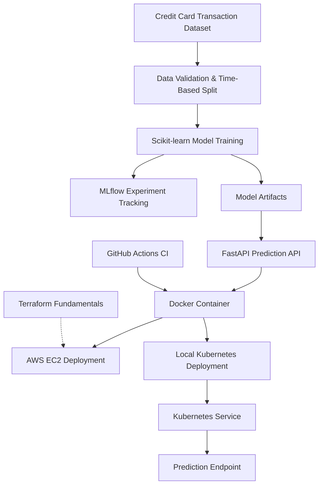

# FraudShield AI

**End-to-End Machine Learning, MLOps, and Cloud Infrastructure Project**

FraudShield AI is a credit card fraud detection system that demonstrates the complete machine learning deployment lifecycle from data validation and model training to containerization, automated testing, cloud deployment, and Kubernetes orchestration.

The project uses **Scikit-learn, FastAPI, MLflow, Docker, GitHub Actions, AWS EC2, Terraform, and Kubernetes** to demonstrate practical MLOps and DevOps engineering skills.

## Architecture



**Deployment environments:**

- **AWS EC2:** Docker-hosted FastAPI application with local-only port binding and SSH tunnel access.
- **Kubernetes:** Local Kind cluster with a Deployment, ClusterIP Service, health probes, and model artifacts mounted through a Kubernetes Secret.
- **Terraform:** Demonstrates AWS infrastructure inspection, variables, providers, outputs, state, and resource lifecycle management. Terraform does not currently provision the EC2 instance.

## Technology Stack

| Category | Technologies |
|---|---|
| Machine Learning | Python, Scikit-learn, Pandas |
| Model Tracking | MLflow |
| API | FastAPI, Pydantic, Uvicorn |
| Containerization | Docker |
| CI | GitHub Actions |
| Cloud Infrastructure | AWS EC2, Ubuntu Linux |
| Infrastructure as Code | Terraform |
| Container Orchestration | Kubernetes, Kind, kubectl |
| Version Control | Git, GitHub |

## Machine Learning Pipeline

FraudShield uses the publicly available Credit Card Fraud Detection dataset containing **284,807 transactions**, with approximately **0.173% fraudulent transactions**.

The training pipeline:

1. Loads and validates transaction data.
2. Performs a chronological training, validation, and test split.
3. Trains a Scikit-learn pipeline using `StandardScaler` and class-balanced `LogisticRegression`.
4. Evaluates candidate classification thresholds using validation F1 score.
5. Evaluates the selected model on the held-out test set.
6. Saves model artifacts and evaluation metrics.
7. Records experiments using MLflow.

### Model Performance

| Metric | Test Result |
|---|---:|
| Average Precision | 0.744 |
| Precision | ~0.522 |
| Recall | ~0.787 |
| F1 Score | ~0.628 |
| Selected Decision Threshold | 0.99 |

These results reflect the project's held-out test evaluation. They are not production performance guarantees.

## API Endpoints

### `GET /health`

Health endpoint used by the application and Kubernetes readiness/liveness probes.

### `POST /predict`

Accepts a transaction containing:

- `Time`
- `Amount`
- `features` — 28 numeric values corresponding to the dataset's anonymized features

Example request:

```json
{
  "Time": 1000,
  "Amount": 50.0,
  "features": [
    0, 0, 0, 0, 0, 0, 0,
    0, 0, 0, 0, 0, 0, 0,
    0, 0, 0, 0, 0, 0, 0,
    0, 0, 0, 0, 0, 0, 0
  ]
}
```

Example response from the local Kubernetes deployment:

```json
{
  "fraud_probability": 0.015427211830638762,
  "fraud_prediction": 0,
  "threshold": 0.99
}
```

The sample uses synthetic inputs and demonstrates successful inference, not the correctness of a real-world fraud decision.

## Run Locally

### Prerequisites

- Python 3.13
- Docker
- Git

Clone the repository:

```bash
git clone https://github.com/Francisogbankwa/fraudshield-mlops.git
cd fraudshield-mlops
```

Create and activate a virtual environment.

Windows PowerShell:

```powershell
python -m venv .venv
.\.venv\Scripts\Activate.ps1
pip install -r requirements.txt
```

The trained model files are excluded from version control. Generate them using the training pipeline or supply previously trained artifacts in the `models/` directory.

Run the API:

```powershell
uvicorn src.api:app --reload
```

Open the interactive documentation at:

`http://localhost:8000/docs`

## Docker

Build the container image:

```bash
docker build -t fraudshield-api:latest .
```

Run the container with locally available model artifacts:

```bash
docker run --rm -p 127.0.0.1:8000:8000 -v "./models:/app/models:ro" fraudshield-api:latest
```

The bind-mount example is intended for Linux-compatible shell environments. On Windows, adjust the host path as needed.

The trained model is mounted at runtime rather than embedded in the Docker image.

## Kubernetes Deployment (Kind)

The project includes Kubernetes manifests under `k8s/`.

### 1. Create a local cluster

```bash
kind create cluster --name fraudshield
```

### 2. Build and load the image

```bash
docker build -t fraudshield-api:latest .
kind load docker-image fraudshield-api:latest --name fraudshield
```

### 3. Provide model artifacts

From the repository root, with the trained model files present:

```bash
kubectl create secret generic fraudshield-model \
  --from-file=fraud_model.joblib=./models/fraud_model.joblib \
  --from-file=threshold.json=./models/threshold.json
```

The Kubernetes Secret supplies the model artifacts to the application at `/app/models`. This is a local demonstration approach; production deployments should use appropriate artifact storage and access controls.

### 4. Deploy the application

```bash
kubectl apply -f k8s/deployment.yaml
kubectl apply -f k8s/service.yaml
kubectl rollout status deployment/fraudshield-api
```

### 5. Access the API

```bash
kubectl port-forward service/fraudshield-service 8001:8000
```

Open:

`http://localhost:8001/docs`

The local Kubernetes deployment was verified with a healthy Pod and a successful prediction response.

## AWS EC2 Deployment

FraudShield was also deployed to an Ubuntu EC2 instance using Docker.

The deployment uses:

- Docker containerization
- Read-only mounted model artifacts
- Container restart policy
- Localhost-bound application port
- SSH port forwarding for access
- Application latency and error logging

The EC2 deployment is a separate environment from the local Kubernetes cluster.

## Terraform

The `terraform/` directory demonstrates Infrastructure as Code fundamentals:

- AWS and local providers
- Input variables
- AWS EC2 data source
- Terraform outputs
- Local file resource
- Terraform state
- Plan, apply, and resource replacement

The configuration reads an existing EC2 instance and manages a local information file. It does not currently create or manage the EC2 instance itself.

## CI and Testing

GitHub Actions automatically runs the project's Python test suite and builds the Docker image after successful tests.

The project has eight passing automated tests.

The CI workflow validates code and container buildability. Automated deployment to AWS or Kubernetes is not yet implemented.

## Monitoring and Reliability

Implemented reliability features include:

- FastAPI health endpoint
- Kubernetes readiness and liveness probes
- Application request latency logging
- Prediction success/error logging
- Docker restart policy on EC2
- Kubernetes Deployment reconciliation and Pod replacement

The project demonstrates application-level observability but does not yet include a centralized metrics dashboard or production alerting system.

## Key Engineering Lessons

This project demonstrates how to:

- Build a reproducible machine learning training pipeline.
- Address severe class imbalance and tune a decision threshold.
- Serve model predictions through a validated REST API.
- Separate model artifacts from application container images.
- Automate testing and Docker builds with GitHub Actions.
- Deploy and troubleshoot Docker containers on AWS EC2.
- Use Terraform providers, variables, data sources, state, and lifecycle operations.
- Deploy a containerized ML API to Kubernetes with health probes and a Service.
- Diagnose and verify deployments using CLI tools and application responses.

## Future Improvements

- Publish versioned Docker images to a container registry.
- Add automated deployment workflows.
- Introduce centralized monitoring and alerting.
- Implement model drift and data quality monitoring.
- Expand infrastructure provisioning through Terraform.
- Evaluate managed Kubernetes only when workload requirements justify its complexity and cost.

## Author

**Francis Ogbankwa**

Software Engineering | DevOps | Cloud Infrastructure | MLOps

[GitHub](https://github.com/Francisogbankwa) | [LinkedIn](https://www.linkedin.com/in/francisogbankwa/)

---

*FraudShield AI is an educational engineering project and is not intended for real-world financial fraud decisions without additional validation, security controls, and operational safeguards.*
